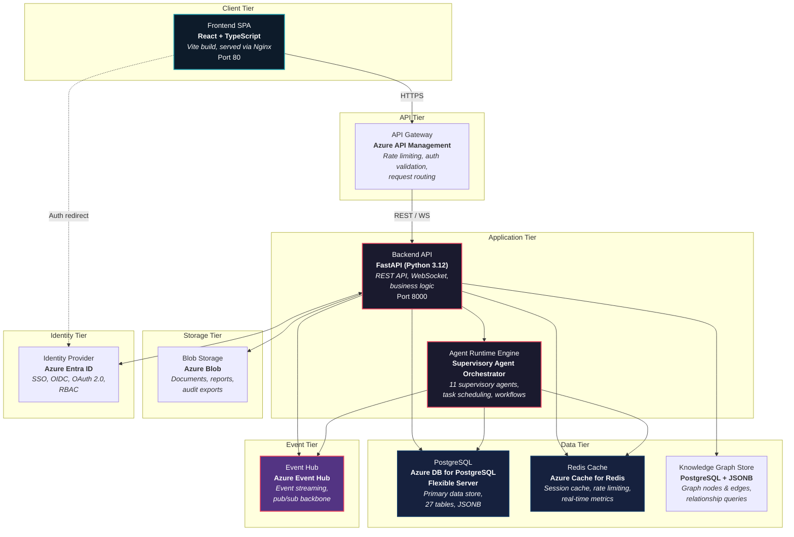
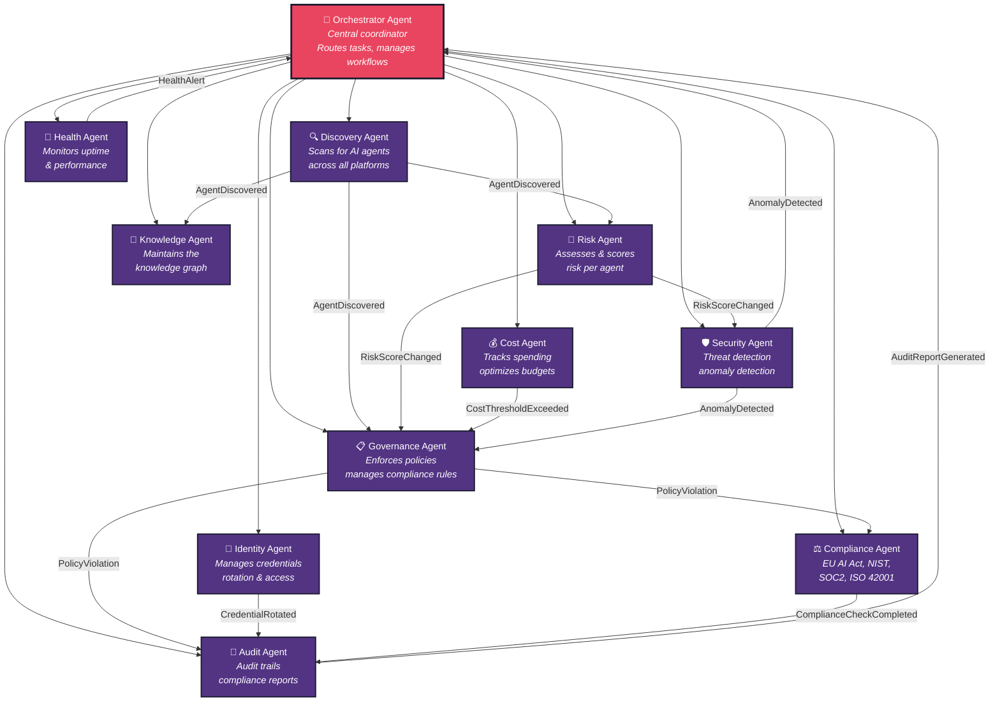
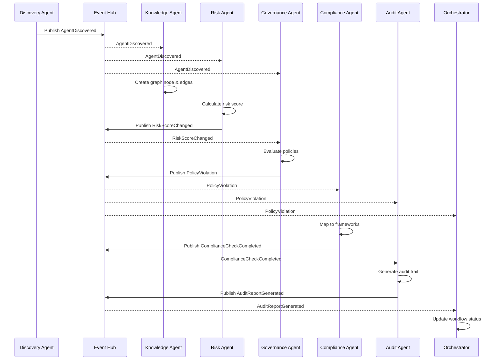
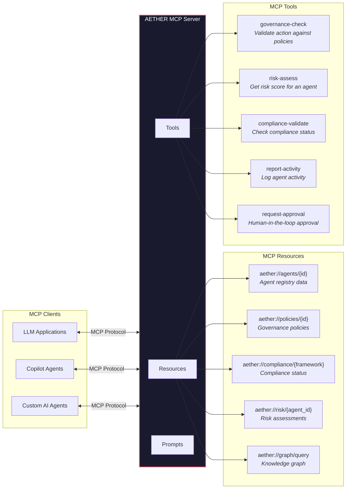
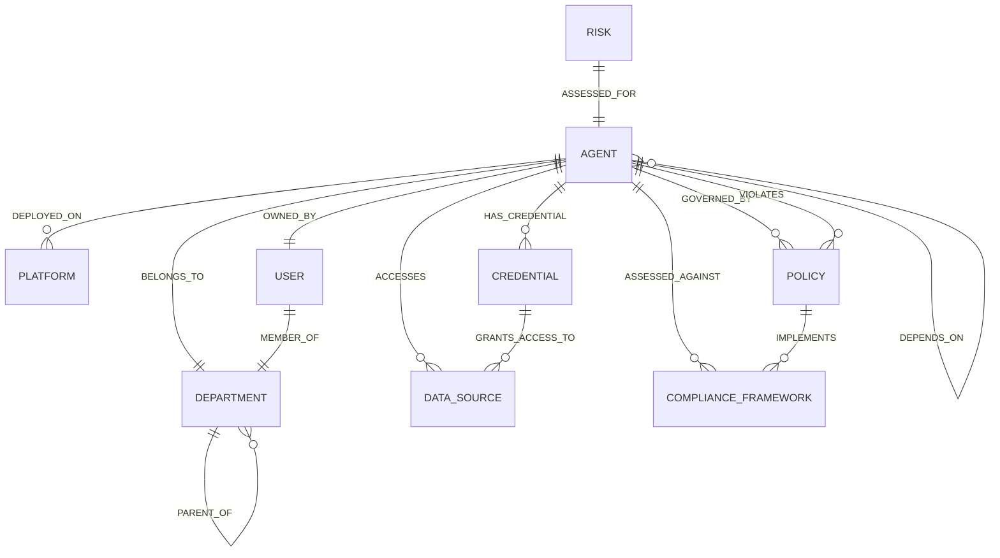
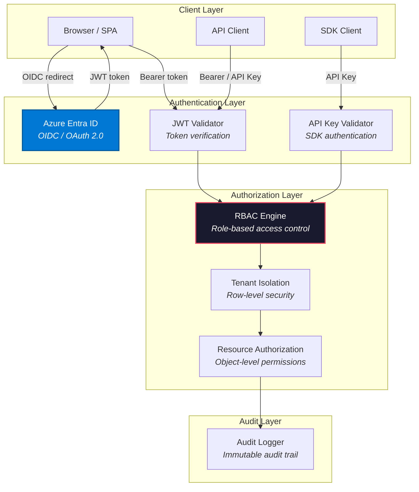
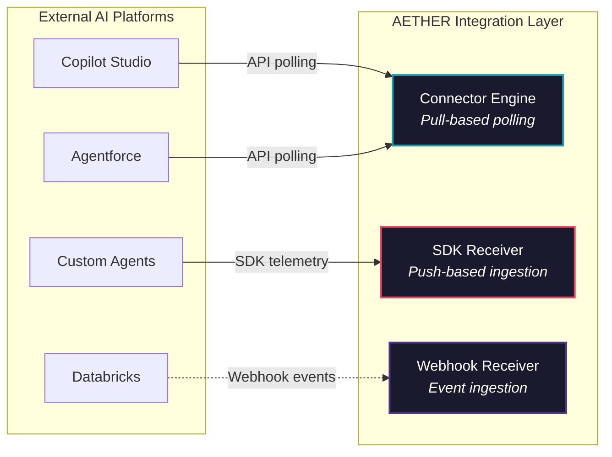

# AETHER Platform — System Architecture Overview

> **Version:** 1.0.0 | **Last Updated:** 2026-06-15 | **Status:** Living Document  
> **Classification:** Internal — Architecture Team

---

## Table of Contents

1. [Executive Summary](#1-executive-summary)
2. [C4 Context Diagram](#2-c4-context-diagram)
3. [C4 Container Diagram](#3-c4-container-diagram)
4. [Multi-Agent Architecture](#4-multi-agent-architecture)
5. [Event-Driven Architecture](#5-event-driven-architecture)
6. [MCP & A2A Protocol Design](#6-mcp--a2a-protocol-design)
7. [Knowledge Graph Architecture](#7-knowledge-graph-architecture)
8. [Security Architecture](#8-security-architecture)
9. [Integration Patterns](#9-integration-patterns)

---

## 1. Executive Summary

### The Enterprise AI Workforce Challenge

Enterprises are rapidly deploying AI agents across every function — customer service bots in **Microsoft Copilot Studio**, sales automation in **Salesforce Agentforce**, data pipelines in **Databricks**, custom reasoning agents built with **LangChain**, **LangGraph**, and **AutoGen**, and foundation-model agents on **AWS Bedrock** and **Google Vertex AI**.

The result is an **ungoverned, invisible, and uncoordinated AI workforce** operating across the enterprise with:

- **No central registry** — IT doesn't know how many agents exist or where they run
- **No governance** — Agents access PII, make financial decisions, and call external APIs without oversight
- **No compliance posture** — Regulatory frameworks (EU AI Act, NIST AI RMF, ISO 42001) require inventories and risk assessments that don't exist
- **No cost visibility** — Token spend and compute costs are scattered across billing accounts
- **No identity management** — Agent credentials are manually provisioned, rarely rotated, and often over-privileged
- **No operational observability** — Health, performance, and error data are siloed per platform

### AETHER: The Operating System for Enterprise AI Workforces

**AETHER** (Autonomous Enterprise Technology for Harmonized, Ethical, and Responsible AI) is the **unified control plane** — the operating system, system of record, and control tower — for every AI agent operating within the enterprise.

AETHER provides eight core capabilities:

| Capability | Description |
|---|---|
| **Discovery** | Automatically find and inventory every AI agent across all platforms |
| **Governance** | Define, enforce, and audit policies that control agent behavior |
| **Compliance** | Map agents to regulatory frameworks and generate evidence |
| **Risk Management** | Assess, score, and monitor risk for every agent continuously |
| **Cost Optimization** | Track token spend, compute costs, and optimize budgets |
| **Identity Management** | Provision, rotate, and validate agent credentials |
| **Health Monitoring** | Monitor uptime, latency, error rates, and performance |
| **Orchestration** | Coordinate supervisory agents that automate governance operations |

### Design Principles

1. **Platform-Agnostic** — Works with every AI agent platform, framework, and runtime
2. **Event-Driven** — All state changes propagate as events through a pub/sub backbone
3. **Multi-Tenant** — Full data isolation between tenants with shared infrastructure
4. **API-First** — Every capability is exposed through a versioned REST API
5. **Zero-Trust** — Every request is authenticated, authorized, and audited
6. **Extensible** — Plugin architecture for connectors, policies, and compliance frameworks

---

## 2. C4 Context Diagram

The context diagram shows AETHER's position in the enterprise landscape and its relationships with external actors and systems.

```mermaid
graph TB
    subgraph Users["Enterprise Users"]
        BU["Business Users<br/><i>Monitor agent performance</i>"]
        IT["IT Administrators<br/><i>Manage integrations & infra</i>"]
        CO["Compliance Officers<br/><i>Audit & regulatory reporting</i>"]
        CX["CIO / CTO<br/><i>Executive dashboards</i>"]
    end

    subgraph AETHER_PLATFORM["AETHER Platform"]
        AETHER["AETHER<br/><b>Enterprise AI Workforce<br/>Control Plane</b><br/><i>Discovers, governs, monitors,<br/>and orchestrates all AI agents</i>"]
    end

    subgraph AI_Platforms["External AI Platforms"]
        COPILOT["Microsoft Copilot Studio<br/><i>Conversational AI agents</i>"]
        AGENTFORCE["Salesforce Agentforce<br/><i>CRM automation agents</i>"]
        DATABRICKS["Databricks<br/><i>Data & ML agents</i>"]
        BEDROCK["AWS Bedrock<br/><i>Foundation model agents</i>"]
        VERTEX["Google Vertex AI<br/><i>ML pipeline agents</i>"]
        CUSTOM["Custom Agents<br/><i>LangChain / LangGraph / AutoGen</i>"]
    end

    subgraph Enterprise_Systems["Enterprise Systems"]
        ENTRA["Azure Entra ID<br/><i>Identity & SSO</i>"]
        SNOW["ServiceNow<br/><i>ITSM & workflows</i>"]
        JIRA["Jira<br/><i>Issue tracking</i>"]
        SLACK["Slack / Teams<br/><i>Notifications</i>"]
    end

    subgraph Data_Sources["Data Sources"]
        LAKE["Data Lakes<br/><i>Azure Data Lake / S3</i>"]
        APIS["Enterprise APIs<br/><i>Internal services</i>"]
        DBS["Databases<br/><i>SQL / NoSQL stores</i>"]
    end

    REG["Regulatory Bodies<br/><i>EU AI Act, NIST, SOC2,<br/>ISO 42001</i>"]

    BU & IT & CO & CX --> AETHER
    AETHER <--> COPILOT & AGENTFORCE & DATABRICKS & BEDROCK & VERTEX & CUSTOM
    AETHER <--> ENTRA & SNOW & JIRA & SLACK
    AETHER -.->|monitors| LAKE & APIS & DBS
    AETHER -.->|compliance reports| REG

    style AETHER fill:#1a1a2e,stroke:#e94560,stroke-width:3px,color:#fff
    style Users fill:#16213e,stroke:#0f3460,color:#fff
    style AI_Platforms fill:#1a1a2e,stroke:#533483,color:#fff
    style Enterprise_Systems fill:#16213e,stroke:#0f3460,color:#fff
    style Data_Sources fill:#16213e,stroke:#0f3460,color:#fff
```



### Actor Descriptions

| Actor | Role | Interaction |
|---|---|---|
| **Business Users** | Agent owners and operators | View dashboards, manage owned agents, review alerts |
| **IT Administrators** | Platform operators | Configure integrations, manage infrastructure, onboard tenants |
| **Compliance Officers** | Regulatory assurance | Run compliance assessments, generate audit reports, review findings |
| **CIO / CTO** | Executive leadership | Executive dashboards, cost summaries, risk posture overview |
| **AI Platforms** | Agent hosting environments | AETHER discovers and monitors agents running on these platforms |
| **Enterprise Systems** | Supporting infrastructure | Identity, ticketing, notifications, and workflow integration |

---

## 3. C4 Container Diagram

The container diagram shows the major deployable units within the AETHER platform.



### Container Specifications

| Container | Technology | Purpose | Scaling |
|---|---|---|---|
| Frontend SPA | React 18, TypeScript 5, Vite 5 | User interface, dashboards, management | 2–5 replicas |
| API Gateway | Azure API Management | Auth validation, rate limiting, routing | Managed service |
| Backend API | FastAPI, Python 3.12, Uvicorn | REST API, business logic, WebSocket | 3–10 replicas (HPA) |
| Agent Runtime | Python, async orchestrator | Supervisory agent execution | 2–5 replicas |
| PostgreSQL | Azure PostgreSQL Flex, v15 | Primary relational store (27 tables) | HA with standby |
| Redis | Azure Cache for Redis, v7 | Caching, sessions, rate limiting | Standard C2 |
| Event Hub | Azure Event Hub | Event streaming, pub/sub | Standard tier, 4 TUs |
| Knowledge Graph | PostgreSQL + JSONB | Graph nodes, edges, relationships | Shared with primary PG |
| Blob Storage | Azure Blob Storage | Documents, audit exports, reports | Hot + Cool tiers |
| Entra ID | Azure Entra ID | SSO, OIDC/OAuth 2.0, RBAC | Managed service |

---

## 4. Multi-Agent Architecture

AETHER employs **11 specialized supervisory agents** that collaboratively govern the enterprise AI workforce. The **Orchestrator Agent** acts as the central coordinator, delegating tasks and managing cross-agent workflows.



### Supervisory Agent Specifications

| # | Agent | Responsibilities | Trigger | Frequency |
|---|---|---|---|---|
| 1 | **Orchestrator** | Central task routing, cross-agent workflow coordination, escalation management | Event-driven | Continuous |
| 2 | **Discovery** | Scan enterprise platforms for agents, detect new/changed/removed agents | Scheduled + On-demand | Every 15 min |
| 3 | **Governance** | Evaluate agents against policies, enforce actions (warn/block/audit), manage policy lifecycle | Event-driven | On agent change |
| 4 | **Compliance** | Map agents to frameworks (EU AI Act, NIST AI RMF, SOC 2, ISO 42001), run assessments, generate evidence | Scheduled | Daily + On-demand |
| 5 | **Risk** | Calculate risk scores (data sensitivity, autonomy, impact, access scope), detect risk changes | Event-driven | On agent change |
| 6 | **Cost** | Aggregate token/compute/API costs, detect budget overruns, recommend optimizations | Scheduled | Hourly |
| 7 | **Identity** | Provision credentials, enforce rotation policies, detect expired/compromised credentials | Scheduled + Event | Every 5 min |
| 8 | **Health** | Aggregate heartbeats, calculate uptime/latency/error rates, detect degradation | Continuous | Real-time |
| 9 | **Audit** | Generate audit trails, produce compliance reports, create executive summaries | Event-driven + Scheduled | On event + Weekly |
| 10 | **Knowledge** | Update knowledge graph nodes/edges, resolve relationships, answer graph queries | Event-driven | On agent change |
| 11 | **Security** | Detect anomalous behavior, unauthorized access, prompt injection attempts, data exfiltration | Continuous | Real-time |

### Cross-Agent Workflows

**Example: New Agent Discovery Workflow**

1. **Discovery Agent** scans Copilot Studio → finds new agent → emits `AgentDiscovered`
2. **Knowledge Agent** creates graph node, establishes relationships
3. **Risk Agent** performs initial risk assessment → emits `RiskScoreChanged`
4. **Governance Agent** evaluates against all active policies
5. **Compliance Agent** maps to relevant regulatory frameworks
6. **Identity Agent** provisions credentials, sets rotation policy
7. **Health Agent** begins monitoring heartbeats
8. **Cost Agent** initializes cost tracking
9. **Audit Agent** records full onboarding trail

---

## 5. Event-Driven Architecture

### Event Backbone

AETHER uses **Azure Event Hub** as the central event backbone. All state changes, alerts, and inter-agent communication flow through the event system using a **publish-subscribe** pattern.

### Event Types

| Event Type | Source | Consumers | Severity |
|---|---|---|---|
| `AgentDiscovered` | Discovery Agent | Knowledge, Risk, Governance, Compliance | Info |
| `AgentOnboarded` | API / Orchestrator | All agents | Info |
| `AgentOffboarded` | API / Orchestrator | All agents | Info |
| `PolicyViolation` | Governance Agent | Compliance, Audit, Security, Orchestrator | High |
| `RiskScoreChanged` | Risk Agent | Governance, Security, Orchestrator | Medium |
| `HealthAlert` | Health Agent | Orchestrator, Security | High |
| `CostThresholdExceeded` | Cost Agent | Governance, Orchestrator | Medium |
| `ComplianceCheckCompleted` | Compliance Agent | Audit, Orchestrator | Info |
| `AuditReportGenerated` | Audit Agent | Orchestrator | Info |
| `CredentialRotated` | Identity Agent | Audit, Security | Low |
| `AnomalyDetected` | Security Agent | Governance, Orchestrator | Critical |
| `ConfigurationChanged` | API | All agents | Low |

### Event Schema

All events conform to a standardized envelope:

```json
{
  "id": "evt_01J7X9K2M3N4P5Q6R7S8T9U0",
  "type": "PolicyViolation",
  "source": "governance-agent",
  "spec_version": "1.0",
  "timestamp": "2026-06-15T14:30:00.000Z",
  "tenant_id": "tenant_acme_corp",
  "correlation_id": "corr_01J7X9K2M3N4P5Q6R7S8T9U0",
  "severity": "high",
  "payload": {
    "agent_id": "agent_01J7X9K2",
    "policy_id": "pol_pii_access",
    "violation_type": "unauthorized_pii_access",
    "description": "Agent accessed PII data without approved governance signal",
    "evidence": {
      "data_source": "customer_db",
      "data_type": "personal_information",
      "timestamp": "2026-06-15T14:29:55.000Z"
    },
    "recommended_action": "suspend_agent"
  }
}
```

### Event Flow — Sequence Diagram



### Event Hub Topology

| Hub Name | Partitions | Retention | Consumer Groups |
|---|---|---|---|
| `aether-agent-lifecycle` | 4 | 7 days | orchestrator, knowledge, audit |
| `aether-governance` | 4 | 14 days | compliance, audit, security |
| `aether-health` | 8 | 3 days | orchestrator, security |
| `aether-cost` | 2 | 7 days | governance, orchestrator |
| `aether-security` | 4 | 30 days | governance, orchestrator, audit |
| `aether-compliance` | 4 | 30 days | audit, orchestrator |

---

## 6. MCP & A2A Protocol Design

### Model Context Protocol (MCP) Integration

AETHER implements an **MCP Server** that exposes its data as structured context for LLMs and AI agents. This allows any MCP-compatible client to query the AETHER knowledge base.



#### MCP Resource URIs

| Resource URI | Description | Returns |
|---|---|---|
| `aether://agents` | List all agents in tenant | Agent summary array |
| `aether://agents/{id}` | Agent detail with risk/compliance | Full agent profile |
| `aether://policies` | All active governance policies | Policy array |
| `aether://policies/{id}` | Policy detail with rules | Full policy spec |
| `aether://compliance/{framework}` | Compliance status by framework | Framework assessment |
| `aether://risk/{agent_id}` | Risk assessment for agent | Risk score + factors |
| `aether://graph/query` | Knowledge graph query | Graph query results |

#### MCP Tool Specifications

```json
{
  "name": "governance-check",
  "description": "Check if a proposed agent action complies with active governance policies",
  "inputSchema": {
    "type": "object",
    "properties": {
      "agent_id": { "type": "string", "description": "The agent performing the action" },
      "action": { "type": "string", "description": "The action to validate" },
      "data_types": { "type": "array", "items": { "type": "string" }, "description": "Data types involved" },
      "target_systems": { "type": "array", "items": { "type": "string" }, "description": "Systems being accessed" }
    },
    "required": ["agent_id", "action"]
  }
}
```

### Agent-to-Agent (A2A) Protocol

AETHER implements the **Google A2A protocol** for inter-agent communication, enabling supervisory agents and managed agents to communicate using standardized messages.

#### A2A Agent Card

Each agent publishes an **Agent Card** at `/.well-known/agent.json`:

```json
{
  "name": "AETHER Governance Agent",
  "description": "Evaluates AI agents against enterprise governance policies",
  "url": "https://api.aether-platform.com/a2a/governance",
  "version": "1.0.0",
  "capabilities": {
    "streaming": true,
    "pushNotifications": true
  },
  "skills": [
    {
      "id": "policy-evaluation",
      "name": "Policy Evaluation",
      "description": "Evaluate an agent against all active policies",
      "inputModes": ["application/json"],
      "outputModes": ["application/json"]
    }
  ],
  "authentication": {
    "schemes": ["bearer"]
  }
}
```

#### A2A Message Flow

| Step | Method | Endpoint | Purpose |
|---|---|---|---|
| 1 | `GET` | `/.well-known/agent.json` | Discover agent capabilities |
| 2 | `POST` | `/a2a/tasks/send` | Send a task to the agent |
| 3 | `GET` | `/a2a/tasks/{id}` | Check task status |
| 4 | `POST` | `/a2a/tasks/{id}/cancel` | Cancel a running task |

---

## 7. Knowledge Graph Architecture

The AETHER Knowledge Graph captures relationships between all entities in the AI workforce ecosystem.

### Graph Schema



### Node Types

| Node Type | Key Properties | Description |
|---|---|---|
| **Agent** | id, name, platform, status, risk_score | An AI agent in the enterprise |
| **Platform** | id, name, type, vendor | AI platform (Copilot Studio, etc.) |
| **Department** | id, name, code, budget | Organizational unit |
| **User** | id, email, display_name, role | Human user (agent owner, admin) |
| **Policy** | id, name, category, enforcement | Governance policy |
| **Risk** | id, level, score, factors | Risk assessment result |
| **DataSource** | id, name, type, sensitivity | Database, API, or data lake |
| **Credential** | id, type, status, expires_at | Agent credential/identity |
| **ComplianceFramework** | id, name, authority, version | Regulatory framework |

### Edge Types

| Edge Type | From → To | Properties | Description |
|---|---|---|---|
| `DEPLOYED_ON` | Agent → Platform | since, version | Agent runs on this platform |
| `OWNED_BY` | Agent → User | since, role | User owns/manages this agent |
| `BELONGS_TO` | Agent → Department | since | Agent belongs to department |
| `GOVERNED_BY` | Agent → Policy | since, status | Policy governs this agent |
| `ACCESSES` | Agent → DataSource | permission, frequency | Agent accesses this data |
| `HAS_CREDENTIAL` | Agent → Credential | since, active | Agent uses this credential |
| `COMMUNICATES_WITH` | Agent → Agent | protocol, frequency | Agents communicate |
| `DEPENDS_ON` | Agent → Agent | type, criticality | Agent depends on another |
| `VIOLATES` | Agent → Policy | since, severity | Agent violates policy |
| `ASSESSED_AGAINST` | Agent → Framework | status, last_assessed | Compliance assessment |

### Common Graph Queries

```sql
-- Find all agents that access PII data sources
SELECT a.name, ds.name as data_source
FROM knowledge_graph_nodes a
JOIN knowledge_graph_edges e ON a.id = e.source_node_id
JOIN knowledge_graph_nodes ds ON e.target_node_id = ds.id
WHERE a.node_type = 'Agent'
  AND ds.node_type = 'DataSource'
  AND e.edge_type = 'ACCESSES'
  AND ds.properties->>'sensitivity' = 'pii';

-- Find agent dependency chains (2 levels deep)
SELECT a1.label as agent, a2.label as depends_on, a3.label as transitive_dep
FROM knowledge_graph_nodes a1
JOIN knowledge_graph_edges e1 ON a1.id = e1.source_node_id AND e1.edge_type = 'DEPENDS_ON'
JOIN knowledge_graph_nodes a2 ON e1.target_node_id = a2.id
LEFT JOIN knowledge_graph_edges e2 ON a2.id = e2.source_node_id AND e2.edge_type = 'DEPENDS_ON'
LEFT JOIN knowledge_graph_nodes a3 ON e2.target_node_id = a3.id
WHERE a1.tenant_id = :tenant_id;

-- Find all agents violating policies in a department
SELECT a.label as agent, p.label as policy, e.properties->>'severity' as severity
FROM knowledge_graph_nodes a
JOIN knowledge_graph_edges dept_e ON a.id = dept_e.source_node_id AND dept_e.edge_type = 'BELONGS_TO'
JOIN knowledge_graph_nodes d ON dept_e.target_node_id = d.id AND d.label = :department_name
JOIN knowledge_graph_edges viol_e ON a.id = viol_e.source_node_id AND viol_e.edge_type = 'VIOLATES'
JOIN knowledge_graph_nodes p ON viol_e.target_node_id = p.id;
```

---

## 8. Security Architecture

### Authentication & Authorization



### RBAC Model

| Role | Scope | Permissions |
|---|---|---|
| **Platform Admin** | Global | Full system access, tenant management, system configuration |
| **Tenant Admin** | Tenant | Manage tenant users, integrations, and all tenant resources |
| **Governance Manager** | Tenant | Create/edit policies, manage violations, enforcement actions |
| **Compliance Officer** | Tenant | Run assessments, view findings, generate compliance reports |
| **Agent Owner** | Owned agents | View/edit owned agents, view metrics, manage credentials |
| **Viewer** | Tenant (read-only) | View dashboards, agents, metrics (no modifications) |

### Permission Matrix

| Resource | Platform Admin | Tenant Admin | Gov. Manager | Compliance Officer | Agent Owner | Viewer |
|---|:---:|:---:|:---:|:---:|:---:|:---:|
| Agents (all) | CRUD | CRUD | Read | Read | — | Read |
| Agents (owned) | CRUD | CRUD | Read | Read | RUD | Read |
| Policies | CRUD | CRUD | CRUD | Read | Read | Read |
| Violations | CRUD | CRUD | CRUD | Read | Read (own) | Read |
| Compliance | CRUD | CRUD | Read | CRUD | Read | Read |
| Risk | CRUD | CRUD | Read | Read | Read (own) | Read |
| Cost | CRUD | CRUD | Read | Read | Read (own) | Read |
| Integrations | CRUD | CRUD | — | — | — | — |
| Audit Logs | Read | Read | Read | Read | Read (own) | — |
| Users/Roles | CRUD | CRUD | — | — | — | — |
| System Config | CRUD | — | — | — | — | — |

### Multi-Tenant Data Isolation

- **Database Level**: Every table includes `tenant_id` as a mandatory foreign key
- **Query Level**: All API queries automatically filter by the authenticated tenant
- **API Level**: Tenant context extracted from JWT claims, injected into every database query
- **Cache Level**: Redis keys are prefixed with `tenant:{tenant_id}:`
- **Event Level**: Events are partitioned by tenant ID in Event Hub

### Encryption

| Layer | Standard | Implementation |
|---|---|---|
| **Data at Rest** | AES-256 | Azure Storage Service Encryption, PostgreSQL TDE |
| **Data in Transit** | TLS 1.3 | All API endpoints, database connections, Redis |
| **Secrets** | Azure Key Vault | API keys, connection strings, JWT signing keys |
| **Credential Hashes** | bcrypt / Argon2id | Agent credential storage |
| **JSONB Sensitive Fields** | AES-256-GCM | Application-level encryption for sensitive JSONB properties |

---

## 9. Integration Patterns

AETHER supports four methods for integrating with external AI platforms and custom agents.

### Integration Methods Overview



### Method Comparison

| Feature | Connector-Pull | SDK-Push | Webhook | Hybrid |
|---|---|---|---|---|
| **Direction** | AETHER → Platform | Agent → AETHER | Platform → AETHER | Bidirectional |
| **Latency** | Minutes (polling interval) | Real-time | Near real-time | Real-time + periodic |
| **Agent Modification** | None required | SDK integration | Webhook config | SDK + config |
| **Data Completeness** | Limited to API | Full telemetry | Event-driven | Comprehensive |
| **Best For** | SaaS platforms (Copilot, Agentforce) | Custom agents (LangChain, Python) | Platforms with webhook support | Production custom agents |
| **Setup Complexity** | Low (configure connector) | Medium (install SDK) | Low (register URL) | Medium |
| **Reliability** | High (AETHER controls) | Depends on agent | Depends on platform | High |

### Method 1: Connector-Pull

AETHER's built-in connectors periodically poll external platform APIs to discover and monitor agents.

**Supported Connectors:**

| Platform | API | Data Retrieved | Poll Interval |
|---|---|---|---|
| Microsoft Copilot Studio | Power Platform APIs | Agent list, usage stats, error logs | 15 min |
| Salesforce Agentforce | Salesforce REST API | Agent configs, execution logs, metrics | 15 min |
| Databricks | Databricks REST API | Model serving endpoints, usage, costs | 30 min |
| AWS Bedrock | AWS SDK (boto3) | Agent configs, invocation metrics | 30 min |
| Google Vertex AI | Google Cloud API | Endpoint status, prediction metrics | 30 min |

### Method 2: SDK-Push

Custom agents integrate the **AETHER SDK** to push telemetry directly. This provides the richest data.

```python
from aether_sdk import AetherClient

client = AetherClient(api_key="aether_key_xxx", tenant_id="tenant_acme")
agent = client.register_agent(name="My Agent", platform="langchain", environment="production")
agent.start_heartbeat(interval=60)
agent.report_metric("latency_ms", 142, unit="ms")
agent.log_activity(activity_type="inference", tokens_used=1500, was_successful=True)
```

### Method 3: Webhook

External platforms push events to AETHER's webhook endpoints when agent state changes.

**Webhook Endpoint:** `POST https://api.aether-platform.com/v1/integrations/webhooks`

```json
{
  "source": "databricks",
  "event_type": "model_serving.endpoint.status_changed",
  "timestamp": "2026-06-15T14:30:00Z",
  "payload": {
    "endpoint_name": "customer-support-agent",
    "old_status": "READY",
    "new_status": "NOT_READY",
    "error": "Model version deployment failed"
  }
}
```

### Method 4: Hybrid

Combines pull and push for maximum coverage. The connector provides baseline discovery and metrics, while the SDK provides real-time telemetry and governance signals.

**Recommended for production custom agents** that need both platform-level visibility and deep application-level observability.

---

## Appendix A: Technology Stack Summary

| Layer | Technology | Version |
|---|---|---|
| Frontend | React, TypeScript, Vite | 18.x, 5.x, 5.x |
| Backend | FastAPI, Python, Uvicorn | 0.110+, 3.12, 0.30+ |
| Database | PostgreSQL (Azure Flexible Server) | 15+ |
| Cache | Redis (Azure Cache for Redis) | 7.x |
| Events | Azure Event Hub | Standard tier |
| Identity | Azure Entra ID | — |
| Storage | Azure Blob Storage | — |
| Orchestration | Kubernetes (AKS) | 1.28+ |
| IaC | Terraform | 1.6+ |
| CI/CD | GitHub Actions | — |
| Monitoring | Azure Monitor, Application Insights | — |
| Tracing | OpenTelemetry | 1.x |

## Appendix B: Glossary

| Term | Definition |
|---|---|
| **Agent** | An autonomous AI software entity that performs tasks on behalf of users |
| **Supervisory Agent** | An AETHER-internal agent that governs the enterprise AI workforce |
| **Managed Agent** | An external AI agent that is discovered, monitored, and governed by AETHER |
| **MCP** | Model Context Protocol — standard for providing context to LLMs |
| **A2A** | Agent-to-Agent protocol — standard for inter-agent communication |
| **Tenant** | An isolated organizational boundary within AETHER (typically a company or business unit) |
| **Policy** | A governance rule that defines acceptable behavior for managed agents |
| **Violation** | An instance where a managed agent's behavior conflicts with a policy |
| **Risk Score** | A numeric assessment (0–100) of an agent's risk level |
| **Knowledge Graph** | A graph database capturing relationships between all entities in the AI workforce |

---

> **Document Owner:** AETHER Architecture Team  
> **Review Cycle:** Monthly  
> **Next Review:** 2026-07-15
