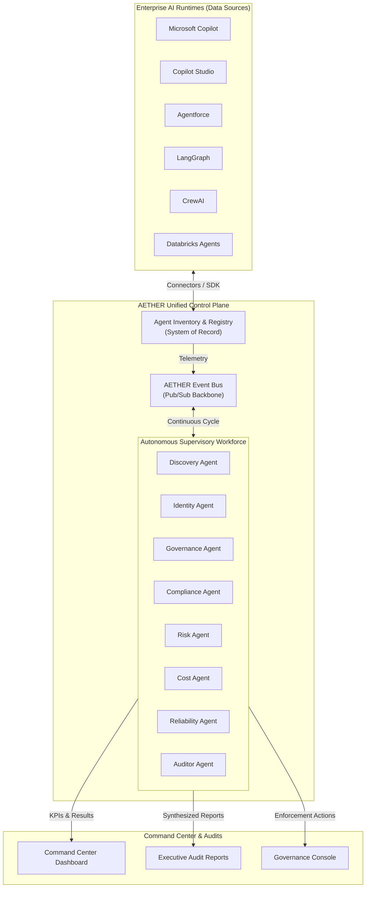

# AETHER Platform — Solution Details & Agentic Architecture

> **Classification:** Executive Summary & Platform Technical Specification  
> **Target Audience:** CIO, CAIO, CISO, Lead Enterprise AI Architects  
> **Status:** Release Technical Specification (v3.0.0)

---

## 1. Executive Summary & Solution Overview

### The Enterprise Challenge: The Invisible AI Workforce
As enterprises aggressively adopt AI agents to automate business processes, they face an governance crisis. AI agents are being built across heterogeneous platforms—**Microsoft Copilot Studio**, **Salesforce Agentforce**, **AWS Bedrock**, **Google Vertex AI**, and custom runtimes utilizing **LangGraph**, **CrewAI**, or **AutoGen**. 

This distributed model results in:
*   **Shadow AI:** IT has no inventory or visibility into where agents run or what credentials they use.
*   **Lack of Governance:** Agents access PII, execute financial transactions, and transfer data across regions without policy enforcement.
*   **Regulatory Risk:** Compliance gaps against frameworks like the EU AI Act, NIST AI RMF, ISO 42001, SOC 2, and GDPR.
*   **Runaway Costs:** Unmonitored token consumption and API licensing charges scattered across billing portals.

### AETHER: The Enterprise AI workforce Control Plane
**AETHER** (Autonomous Enterprise Technology for Harmonized, Ethical, and Responsible AI) is the unified control plane, system of record, and monitoring engine for the enterprise AI workforce. Think of AETHER as **"Workday for AI Workers"** and **"Visa for AI Agents."**

AETHER establishes:
1.  **A Unified Inventory & Registry:** A single pane of glass for discovering, cataloging, and managing AI workers.
2.  **Autonomous Supervisory Agents:** A workforce of 11 AI agents that continuously monitor and optimize the enterprise AI portfolio.
3.  **Active Governance & Enforcement:** Real-time policy evaluation and automated compliance mapping.



---

## 2. The Multi-Agent Supervisory Architecture

AETHER governs the enterprise AI workforce by deploying a dedicated workforce of **11 autonomous supervisory agents**. These agents analyze the telemetry, behavior, and configurations of registered AI workers.

### The 11 Supervisory Agents Specification

| Icon | Agent Name | System Purpose | Trigger / Schedule | Primary Outputs | Key Metrics Tracked |
| :---: | :--- | :--- | :--- | :--- | :--- |
| 🔍 | **Discovery Agent** | Continuously scan external platforms via connectors to find unregistered AI agents. | Continuous (300s) | Registered Inventory, Discovery Coverage Score, Discovery Events | Total scans, discovered agents, new agents today, scan coverage, avg scan duration |
| 🪪 | **Identity Agent** | Validate ownership, accountability, sponsor mapping, and credentials rotation for all agents. | Continuous (600s) | Identity Score (0-100), Orphan Agent Alerts, Credential Rotation Warnings | Avg identity score, orphan agents count, unauthorized agents, pending rotations |
| 🛡️ | **Governance Agent** | Enforce the 8 enterprise AI policies, trigger approval workflows, and initiate blocking/escalations. | Continuous (60) | Governance Score, Policy Violations, Enforcement Actions (Block/Notify) | Policies evaluated, active violations, automated block actions, escalations |
| ✅ | **Compliance Agent** | Continuously maps agent configurations to regulatory control frameworks and audits gaps. | Hourly | Compliance Score, Audit Readiness, Gap Analysis Reports | Controls evaluated, controls passed, open findings, framework-specific compliance (SOC2, GDPR, HIPAA, etc.) |
| ⚠️ | **Risk Agent** | Perform LLM-based multi-factor risk assessment, computing risk scores and classifying threat level. | Continuous (300s) | Risk Score (0-100), Risk Level (Low-Critical), Reasoning, Risk Factors | Agents assessed, critical/high/medium/low risk counts, avg risk score, risk trend |
| 💰 | **Cost Agent** | Monitor token budgets, compute consumption, licensing costs, and generate optimization suggestions. | Continuous (300s) | Cost per Agent, Cost per Task, Department Spend, Optimization Recommendations | Total monthly spend, avg cost per agent, avg cost per task, budget utilization, savings identified |
| 💓 | **Reliability Agent** | Track operational uptime, query latency, failure rates, and detect service degradation or outages. | Continuous (60) | Reliability Score, Incident Alerts, SLA Compliance, Health Dashboard | Avg availability, avg success rate, avg latency, active incidents, degraded agents count |
| 📊 | **Observability Agent** | Ingest, parse, and correlate logs, events, metrics, and trace spans across all agents. | Continuous (30s) | Agent Health Graph, Telemetry Dashboard, Anomaly Alerts | Events collected, logs processed, traces analyzed, anomalies detected |
| 📈 | **Benchmarking Agent** | Compare agent economics and performance against peers, departments, and industry averages. | Daily | Peer Rankings, Benchmark Scores, Optimization Recommendations | Agents benchmarked, departments ranked, peer variance metrics |
| 🔎 | **Auditor Agent** | Act as chief internal auditor, summarizing findings, evaluating evidence, and generating remediation schedules. | Daily | Synthesized Audit Reports, Executive Findings, Remediation Schedules | Audits completed, open findings, critical findings, avg remediation days |
| 👔 | **AI Workforce Manager** | Act as Chief AI Workforce Officer, generating executive briefings and strategic workforce forecasts. | Daily | Daily Executive Briefings, Weekly Governance Reports, Budget Forecasts | Briefings generated, reports published, recommendations issued, implementation rate |

---

## 3. How KPIs are Programmatically Calculated

KPIs are calculated by the data engine (`js/data.js` via the `computeKPIs` function) using a hybrid approach. It checks for **Live LLM Analysis Results** cached from the Python backend server (`server.py`) and falls back to **Agent Configuration Metadata** if the backend hasn't been run.

```
                  ┌───────────────────────────────┐
                  │   Call AETHER.data.computeKPIs │
                  └───────────────┬───────────────┘
                                  │
                   Is Live LLM Backend Data Available?
                   ┌──────────────┴──────────────┐
                   │ Yes                         │ No
                   ▼                             ▼
       ┌────────────────────────┐    ┌───────────────────────────────┐
       │   Parse Python LLM     │    │  Fallback to Local Javascript │
       │   Agent Results Cache  │    │  Agent Registry Aggregation   │
       └────────────────────────┘    └───────────────────────────────┘
```

### The KPI Mathematical Models & Fallbacks

#### A. Cost & Budget Efficiency
Calculates the monthly run rate and task throughput.
*   **Live LLM Path:** Extracts `total_monthly_spend` and `total_tasks` from the `Cost Agent` analysis payload.
*   **Fallback Path:** Sums the static metadata fields:
    $$\text{Total Cost} = \sum_{i=1}^{N} \text{monthlyCost}_i$$
    $$\text{Total Tasks} = \sum_{i=1}^{N} \text{tasksExecuted}_i$$
*   **Budget Efficiency Score:** Measures the ROI of token spend against tasks executed:
    $$\text{Budget Efficiency} = \min\left(100, \text{round}\left( \frac{\text{Total Tasks} \times \$0.10}{\text{Total Cost}} \times 100 \right)\right)$$

#### B. Risk Posture & Incidents
Determines the risk distribution and severe incidents.
*   **Live LLM Path:** Retrieves `high_risk_count` and `avg_risk_score` from the `Risk Agent` output. If any agent's evaluated risk score exceeds $80$, it flags a critical incident.
*   **Fallback Path:** Computes average from configuration details:
    $$\text{Avg Risk Score} = \text{round}\left( \frac{1}{N} \sum_{i=1}^{N} \text{riskScore}_i \right)$$
    An agent is classified as **High Risk** if $\text{riskScore} \ge 60$ and an **Incident** is triggered if $\text{riskScore} \ge 80$.

#### C. Reliability & Availability
Evaluates SLA adherence.
*   **Live LLM Path:** Iterates over the `Health Agent` array, averaging `health_score` (representing availability) and `response_time_ms` (representing latency).
*   **Fallback Path:** Summarizes individual agent heartbeat configurations:
    $$\text{Avg Availability} = \frac{1}{N} \sum_{i=1}^{N} \text{availability}_i$$
    $$\text{Avg Latency} = \frac{1}{N} \sum_{i=1}^{N} \text{avgLatency}_i \text{ ms}$$

#### D. Compliance Score
Unlike other metrics, **Compliance Score is exclusively assessed by the AI Compliance Agent**. 
*   If the Compliance Agent has not run, the platform reports **"Not Assessed"** ($0\%$).
*   When run, it calculates the average across frameworks or individual agents:
    $$\text{Compliance Score} = \text{round}\left( \frac{1}{M} \sum_{j=1}^{M} \text{framework\_score}_j \right)$$

---

## 4. How Agents Onboard Agents: Programmatic Pipeline

Onboarding is the process of registering and setting up monitoring for an AI agent. It runs through a pipeline defined in `AETHER.config.onboardAgent` within `js/agents-config.js`.

### The Step-by-Step Onboarding Pipeline

#### Step 1: Input Validation & ID Generation
The interface passes the agent form data to `onboardAgent(agentData)`. The engine validates that `name` is present. If no `id` is supplied, it automatically generates a serial identifier:
$$\text{Next ID} = \text{"AGT-"} + \text{String}(\max(\text{Existing IDs}) + 1)\text{.padStart(4, '0')}$$
Duplicate checks are conducted; if the agent ID already exists, the request defaults to `updateAgentConfig()`.

#### Step 2: Platform and Monitoring Method Mapping
The pipeline maps the agent to its platform connector:
*   Checks `platformConnectors` for a name match.
*   Resolves `monitoringMethod` based on platform capability:
    *   **Microsoft integrations:** default to `api-poll`
    *   **LangGraph / Custom:** default to `sdk-push` or `hybrid`
*   Determines endpoints (e.g. appending `/health` and `/metrics` to the agent base URL).

#### Step 3: Creation of the Standardized Registry Entry
A unified JSON schema is generated for the agent, combining identity, deployment topography, risk defaults, and operational history. Below is the structured JSON template instantiated:

```json
{
  "id": "AGT-0012",
  "name": "Customer Support Copilot",
  "platform": "Microsoft Copilot",
  "platformConnectorId": "ms-copilot",
  "owner": "support-lead@contoso.com",
  "department": "Customer Support",
  "costCenter": "CC-Support",
  "sponsor": "VP of Operations",
  "purpose": "Automate level 1 ticket responses",
  "createdDate": "2026-06-16",
  "onboardedDate": "2026-06-16T11:17:25Z",
  "endpoint": "https://api.contoso.com/support-copilot",
  "healthCheckEndpoint": "https://api.contoso.com/support-copilot/health",
  "metricsEndpoint": "https://api.contoso.com/support-copilot/metrics",
  "webhookUrl": null,
  "environment": "Production",
  "region": "us-east-1",
  "runtime": "Microsoft Power Platform",
  "status": "Active",
  "monitoringMethod": "api-poll",
  "riskScore": 45,
  "riskLevel": "Medium",
  "criticality": "Medium",
  "certificationStatus": "Pending",
  "piiAccess": true,
  "financialAccess": false,
  "monthlyCost": 1500,
  "tasksExecuted": 12200,
  "successRate": 98.4,
  "availability": 99.9,
  "avgLatency": 230,
  "tokenUsage": 45000000,
  "connectedSystems": 3,
  "lastSeen": "2026-06-16T11:15:00Z",
  "monitoring": {
    "enabled": true,
    "healthCheck": { "enabled": true, "interval": 60, "endpoint": "..." },
    "metrics": { "collectionInterval": 300, "dimensions": ["cpu", "memory", "tokens"] },
    "alerts": { "enabled": true, "channels": ["slack", "email"], "thresholds": { "errorRate": 5, "latencyMs": 500 } },
    "governance": { "policiesApplied": ["GOV-PII-001", "GOV-FIN-001"], "complianceFrameworks": ["SOC2", "GDPR"] }
  }
}
```

#### Step 4: Storage Persistence
The entry is saved in two places:
1.  **Local Storage:** The local cache is synchronized via `localStorage.setItem('aether_agents_config_v3', ...)`.
2.  **Server Backend:** An HTTP `POST` request is sent to the server (`/api/agents`) to persist the configuration in `server.py` and write it to `agents.json`.

#### Step 5: Pub/Sub Event Broadcast
The system publishes an `AgentOnboarded` event to the `AETHER Event Bus`. Subscribers like the Command Center Activity Feed, the Governance Auditor, and Slack notification channels react instantly:
```javascript
AETHER.events.emit('AgentOnboarded', {
  agentId: entry.id,
  agentName: entry.name,
  platform: entry.platform,
  owner: entry.owner,
  department: entry.department,
  timestamp: new Date().toISOString()
});
```

---

## 5. How AETHER Tracks Agent Activity & Performance

Agent tracking works through **Continuous Monitoring Cycles**, an **Event Bus architecture**, and **Live Agent Run Cycles**.

```
    AETHER.events.emit()  ──►  ┌────────────────────────┐
                               │    AETHER Event Bus    │
                               └───────────┬────────────┘
                                           │
                                           ├─► Dashboard Log Feed
                                           ├─► Alert Engine
                                           └─► Persistent Audit Logs
```

### 1. The AETHER Event Bus
The event bus (`js/event-bus.js`) is the pub/sub core of the platform. It holds a rolling memory buffer of the last $500$ events. 

*   **Simulation Mode (Auto-Play):** If auto-play is enabled, a background interval triggers every $8$-$12$ seconds, generating mock activities (e.g. token spikes, model updates, policy violations) to demonstrate monitoring in real time.
*   **Real-time Event Ingestion:** Connectors, SDK calls, and monitoring checks issue events (e.g., `PolicyViolation`, `AgentDiscovered`, `AgentOnboarded`, `AgentOffboarded`).

### 2. Live Agent Run Cycles (The Live Activity Feed)
When the user clicks the **"Run All Agents"** button in the Command Center:
1.  A request is sent to the backend endpoint `/api/run/all`.
2.  `server.py` runs the 6 analysis agents in sequence:
    $$\text{Compliance} \rightarrow \text{Risk} \rightarrow \text{Governance} \rightarrow \text{Cost} \rightarrow \text{Health} \rightarrow \text{Audit}$$
3.  Each agent runs LLM analysis on the registered agents.
4.  Once complete, `agents-runtime.js` processes the results and pushes **7 specific activities** into the Event Bus, naming each agent and detailing their findings:

| Agent | Icon | Pushed Activity Event Description | Severity |
| :--- | :---: | :--- | :---: |
| **Governance Agent** | 🛡️ | Evaluated violations (e.g., "Evaluated 3 policy violations — enforcement actions applied") | Info |
| **Compliance Agent** | ✅ | Audited posture (e.g., "Compliance score: 94% across 5 frameworks (SOC2, ISO27001, GDPR, SOX, HIPAA)") | Success |
| **Risk Agent** | ⚠️ | Evaluated risk distribution (e.g., "2 high-risk agent(s) identified — risk scores recalculated for all agents") | Warning |
| **Cost Agent** | 💰 | Tracked spend patterns (e.g., "Monthly spend tracked: $24,500 — optimization opportunities identified") | Info |
| **Health Agent** | 💓 | Checked endpoints & availability (e.g., "Health check passed for 12 agents — avg availability 99.5%") | Success |
| **Audit Agent** | 🔎 | Summarized audit report (e.g., "Internal audit completed — agent ownership, access, and value verified") | Info |
| **AETHER Runtime** | 🚀 | Final completion notification (e.g., "All 6 AI agents completed — Governance, Compliance, Risk, Cost, Health, Audit results ready") | Success |

---

## 6. Supported Platform Connectors (12 Integrations)

AETHER integrates out-of-the-box with **12 enterprise platforms and frameworks**, split across Microsoft ecosystems, hyperscalers, open-source development frameworks, and database runtimes.

| Connector ID | Display Name | Connector Category | Target API Endpoint | Auth Method | Permission Scopes |
| :--- | :--- | :--- | :--- | :--- | :--- |
| `ms-copilot` | Microsoft Copilot | Microsoft | `https://graph.microsoft.com/v1.0` | OAuth 2.0 / Microsoft Entra ID | `User.Read.All`, `Application.Read.All`, `AuditLog.Read.All`, `Reports.Read.All` |
| `ms-copilot-studio` | Copilot Studio | Microsoft | `https://api.powerplatform.com/v1` | OAuth 2.0 / Entra ID | `Environment.Read`, `Bot.Read.All`, `Flow.Read.All` |
| `azure-ai-foundry` | Azure AI Foundry | Microsoft | `https://management.azure.com/...` | Azure Managed Identity / SPN | `Reader`, `Contributor` |
| `ms-entra-id` | Microsoft Entra ID | Microsoft | `https://graph.microsoft.com/v1.0/identity` | OAuth 2.0 / Entra ID Client Creds | `Directory.Read.All`, `Application.Read.All`, `AuditLog.Read.All` |
| `openai-assistants` | OpenAI Assistants | OpenAI | `https://api.openai.com/v1` | API Key / Bearer Token | `assistants.read`, `threads.read`, `runs.read` |
| `azure-openai` | Azure OpenAI | Microsoft | `https://{resource}.openai.azure.com/openai` | Managed Identity / API Key | `Cognitive Services OpenAI User` |
| `langgraph` | LangGraph | Open Source | `https://api.smith.langchain.com/v1` | API Key | `runs.read`, `projects.read`, `traces.read` |
| `crewai` | CrewAI | Open Source | `https://api.crewai.com/v1` | API Key | `crews.read`, `agents.read`, `tasks.read` |
| `salesforce-agentforce`| Salesforce Agentforce | Salesforce | `https://contoso.my.salesforce.com/services/data/v62.0` | OAuth 2.0 / JWT Bearer | `api`, `chatter_api`, `einstein_analytics` |
| `databricks` | Databricks Agents | Databricks | `https://contoso.cloud.databricks.com/api/2.0` | Service Principal / PAT | `workspace.read`, `clusters.read`, `serving-endpoints.read` |
| `snowflake-cortex` | Snowflake Cortex | Snowflake | `https://contoso.snowflakecomputing.com/api/v2` | Key Pair / OAuth | `CORTEX_USER`, `DATA_READER` |
| `custom-agents` | Custom Enterprise Agents| Custom / SDK | `https://aether-api.contoso.com/v1/agents` | AETHER SDK / API Key | `agent.register`, `agent.heartbeat`, `agent.metrics` |

---

## 7. Governance Policies & Compliance Posture

### The 8 Default Governance Policies Enforced
The Governance Agent evaluates agents against these 8 policies.

```
       [AI Agent Configuration] ──► [Governance Agent Policy Check]
                                                 │
            ┌─────────────────┬──────────────────┼─────────────────┐
            ▼                 ▼                  ▼                 ▼
       GOV-PII-001       GOV-FIN-001        GOV-COST-001      GOV-MODEL-001
      (PII Checks)     (Finance Limit)     (Budget Check)    (Approved LLM)
```

1.  **GOV-PII-001 (PII Access Control):** Flags any agent processing PII (e.g. email, SSN, phone) without active privacy certification.
2.  **GOV-FIN-001 (Financial Transaction Limit):** Flags agents handling financial operations that do not have multi-factor approvals configured.
3.  **GOV-COST-001 (Cost Anomaly Detection):** Flags agents whose monthly token and runtime costs exceed their designated department budget.
4.  **GOV-AUTH-001 (Unauthorized Agent Detection):** Flags agents discovered by scanners that do not have a registered owner or business sponsor.
5.  **GOV-MODEL-001 (Model Version Control):** Flags agents utilizing unapproved foundation models (e.g. legacy model versions or unvetted external models).
6.  **GOV-DATA-001 (Cross-Region Data Transfer):** Flags agents processing data across geographic boundaries (e.g. EU data routed to US-based LLM endpoints).
7.  **GOV-CERT-001 (Certification Expiry):** Warns when an agent's annual architecture or compliance certification is within 30 days of expiry.
8.  **GOV-IDLE-001 (Idle Agent Detection):** Flags agents with active statuses that have not executed a task or sent a heartbeat in over 30 days.

### Framework Compliance Mapping
The Compliance Agent maps configurations and evidence to five key standards:

*   **SOC 2 (Trust Services Criteria):** Security, confidentiality, and processing integrity controls for SaaS-deployed AI systems.
*   **ISO 27001 (Information Security Management):** Access governance, logging, asset protection, and vulnerability management.
*   **GDPR (General Data Protection Regulation):** User consent, data minimization, right to erasure, and cross-border processing limits.
*   **SOX (Sarbanes-Oxley Act):** Internal control validation for automated agents executing financial calculations or financial reporting.
*   **HIPAA (Health Insurance Portability and Accountability):** Encryption, access logs, and containment of Protected Health Information (PHI).
